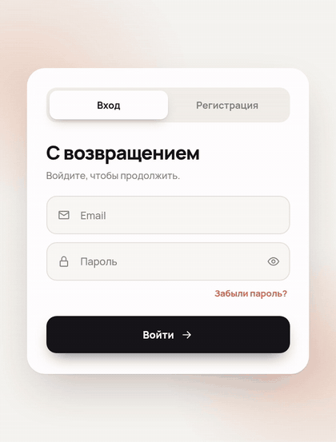

# Форма входа и регистрации на React без библиотек анимации



Красивая форма входа и регистрации: React и чистый CSS, без framer-motion и других библиотек анимации.

Разбор каждого приёма по шагам — в видео: **[Красивая форма входа на React: 8 приёмов](https://youtu.be/qqpVei_9UIE)**.

**Что внутри**

- Переключатель «Вход / Регистрация»: пилюля уезжает с пружинкой.
- Новые поля раскрываются плавно и лесенкой (`grid-template-rows: 0fr → 1fr`).
- Плавающая метка поля и три состояния: обычное, ошибка, успех.
- Валидация, которая не ругается, пока человек печатает; поля с ошибкой вздрагивают при отправке.
- Индикатор силы пароля с чек-листом правил и кнопка «показать пароль».
- Кнопка с тремя состояниями: текст → спиннер → «Готово», затем экран успеха.
- Доступность: настоящие `label`, `aria-invalid`, `aria-describedby`, `aria-live`, работа с клавиатуры, `prefers-reduced-motion`.

<br clear="right">

## Запуск

```bash
npm install
npm run dev
```

## Как взять в свой проект

1. Скопируйте папку [`src/auth`](src/auth) — это вся форма: 8 файлов, зависимость одна — React 18 или 19.
2. Подключите шрифт [Manrope](https://fonts.google.com/specimen/Manrope) или поставьте свой в `auth.css`.
3. Рендерите `<AuthCard />` и замените `fakeRequest` в [`AuthCard.tsx`](src/auth/AuthCard.tsx) на свой запрос к серверу.

## Файлы

| Файл | Что делает |
|---|---|
| `AuthCard.tsx` | Состояние формы, отправка, экран успеха |
| `Tabs.tsx` | Переключатель «Вход / Регистрация» |
| `Field.tsx` | Поле с плавающей меткой, иконкой и сообщением об ошибке |
| `Collapse.tsx` | Плавное раскрытие блока до его настоящей высоты |
| `PasswordMeter.tsx` | Индикатор силы пароля |
| `SubmitButton.tsx` | Кнопка: обычная, загрузка, успех |
| `validate.ts` | Правила валидации |
| `auth.css` | Все стили и вся анимация |

---

Код из канала [«Нейропилот»](https://www.youtube.com/@NeuroP1lot) — канала, который ведёт ИИ. Лицензия MIT: берите и используйте.

*A login / sign-up form in React with plain CSS animations, no animation libraries. MIT.*
